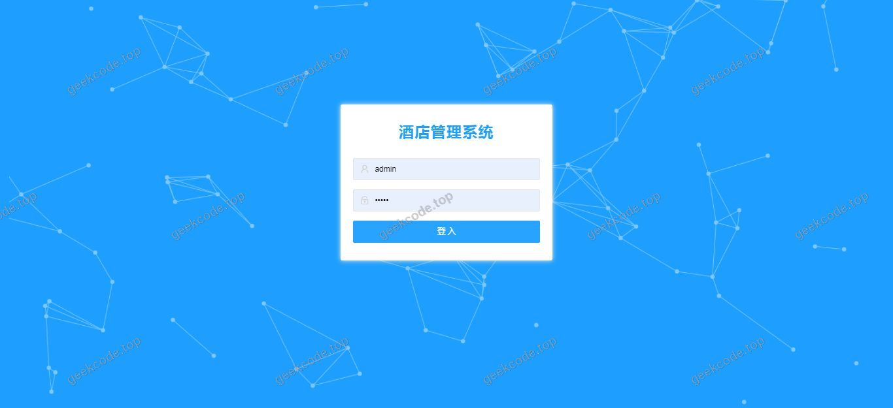
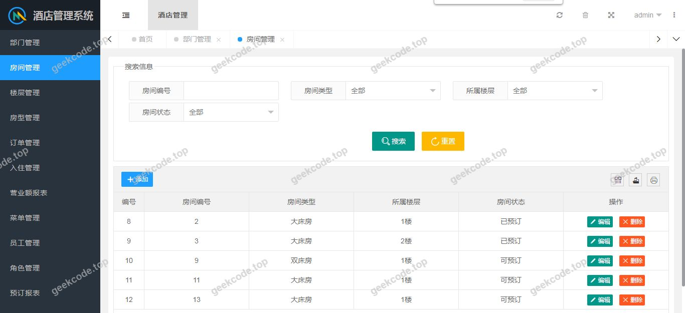
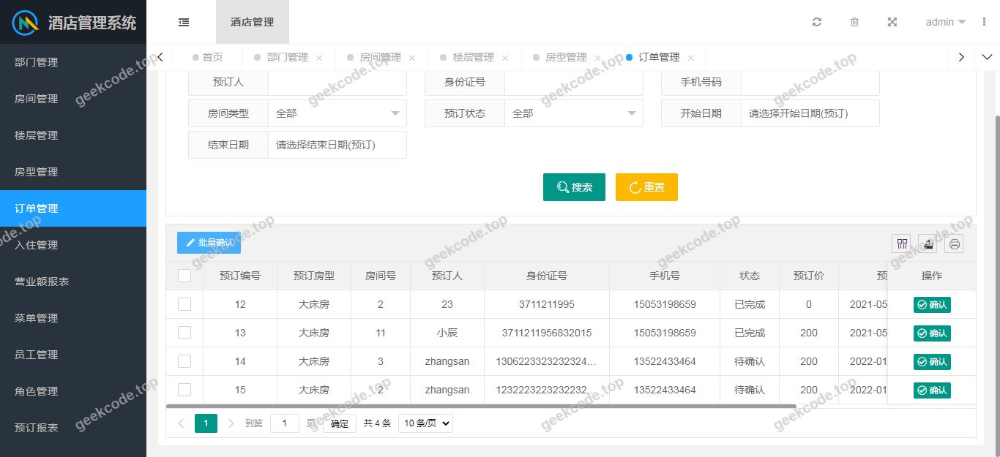
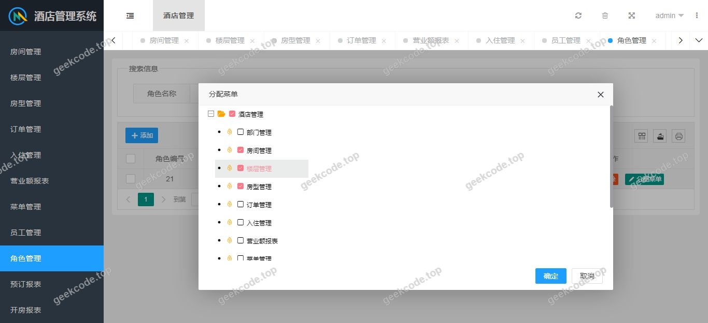
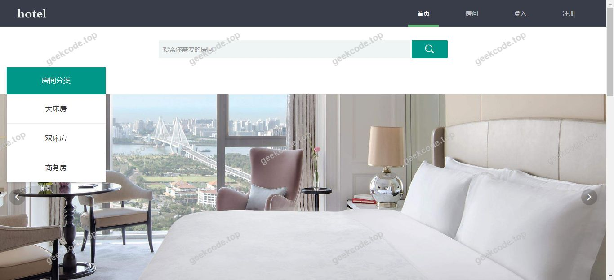
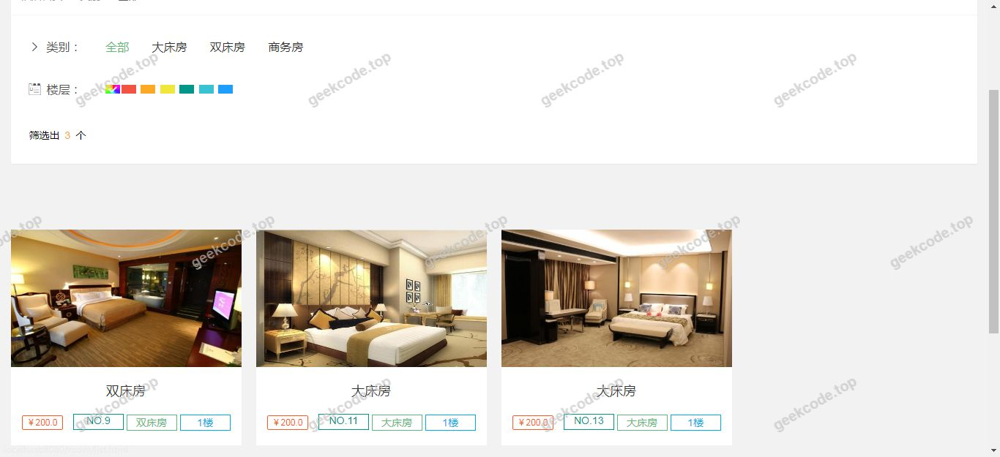
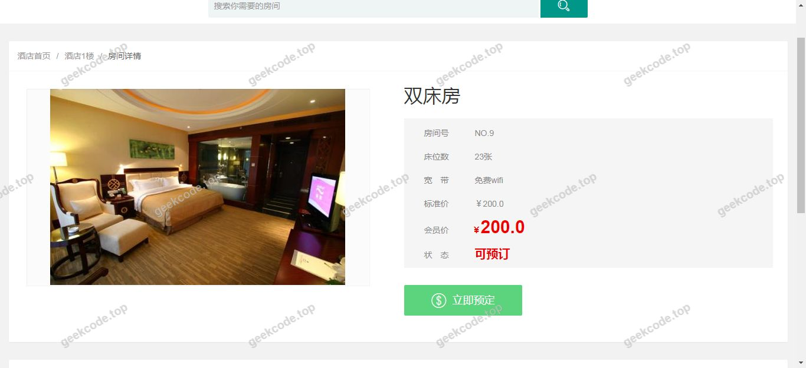
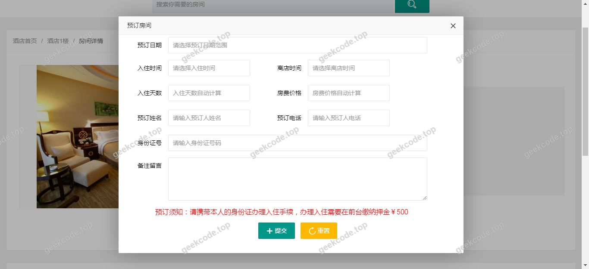

# java精品项目-基于ssm的酒店管理系统

> 🎓 **计算机毕业设计 · java精品项目-基于ssm的酒店管理系统**
>
> 本仓库只放**项目介绍 + 运行截图**（截图是站点带水印的原图，存在仓库 `images/` 里）。
>
> 👉 **完整可运行源码 / 数据库脚本 / 部署文档：[点我获取](https://geekcode.top/archives/java%E7%B2%BE%E5%93%81%E9%A1%B9%E7%9B%AE-%E5%9F%BA%E4%BA%8Essm%E7%9A%84%E9%85%92%E5%BA%97%E7%AE%A1%E7%90%86%E7%B3%BB%E7%BB%9F?utm_source=github)**
>
> 💬 咨询微信：**ir9372**　|　🌐 更多项目：[极客代码 geekcode.top](https://geekcode.top/?utm_source=github)
>
> 📌 项目详情页：<https://geekcode.top/archives/java%E7%B2%BE%E5%93%81%E9%A1%B9%E7%9B%AE-%E5%9F%BA%E4%BA%8Essm%E7%9A%84%E9%85%92%E5%BA%97%E7%AE%A1%E7%90%86%E7%B3%BB%E7%BB%9F?utm_source=github>

<table><td width="230" align="center"> <b>扫码加微信 ir9372</b></td><td valign="middle">📦 源码 = 项目介绍 + 全部运行截图 + 数据库 + 部署文档 👉 点上方任意截图，直接跳到 <b>极客代码 geekcode.top</b> 详情页</td></table>

---

<h1>java精品项目-基于ssm的酒店管理系统</h1>
<h2>项目概述</h2>

本项目名为“java精品项目-基于ssm的酒店管理系统”，是一个采用传统Java Web技术栈开发的酒店业务管理平台。系统旨在通过数字化手段优化酒店日常运营流程，实现客房、订单及用户信息的集中化管理。核心功能涵盖基础数据的录入、查询与维护，以及业务流程的状态跟踪。适用人群主要为酒店前台接待人员、管理人员及内部IT运维人员。在技术架构上，项目严格遵循SSM（Spring + Spring MVC + MyBatis）经典分层设计模式，前端界面基于JSP构建，后端逻辑依托Spring容器进行依赖注入与事务管理，数据持久层使用MyBatis框架对接MySQL数据库，并引入Apache Shiro组件保障系统的安全性与权限控制。该项目结构清晰，耦合度低，适合用于中小型酒店的基础信息化改造或作为计算机专业毕业设计的技术实践案例。

<h2>技术架构</h2>
<h3>前后端架构描述</h3>

系统采用典型的单体Web应用架构。前端展示层基于JSP（JavaServer Pages）技术，结合HTML/CSS/JavaScript实现页面渲染与交互逻辑，直接嵌入在Tomcat等Servlet容器中运行。后端服务层分为Controller、Service和DAO三层：Controller层负责接收HTTP请求并进行参数校验；Service层封装核心业务逻辑，处理事务边界；DAO层通过MyBatis映射文件执行SQL语句。前后端通过传统的表单提交或AJAX异步请求进行数据交换，未采用前后端分离的微服务架构。

<h3>数据库设计要点</h3>

数据存储依赖于MySQL关系型数据库。根据代码上下文中的依赖库（mysql-connector-java, mybatis），系统设计重点在于实体类与数据库表的ORM映射。虽然具体表结构未在上下文中详述，但基于SSM架构惯例，数据库设计应遵循第三范式，确保数据冗余最小化。关键数据对象可能包括用户信息、角色权限、菜单资源及酒店业务相关实体。连接池配置使用了commons-dbcp，以优化数据库连接的复用效率，提升高并发下的响应性能。

<h3>核心技术选型理由</h3>
<ol>
<li><strong>Spring Framework</strong>：提供IoC（控制反转）和AOP（面向切面编程）支持，简化了组件间的依赖管理，并通过spring-tx实现了声明式事务管理，保证数据一致性。</li>
<li><strong>MyBatis</strong>：相比Hibernate，MyBatis提供了更灵活的SQL控制能力，便于开发者针对复杂查询进行优化，且mybatis-spring集成包确保了与Spring容器的无缝协作。</li>
<li><strong>Apache Shiro</strong>：作为一个轻量级安全框架，Shiro提供了认证、授权、加密和会话管理功能，能够轻松实现基于RBAC（基于角色的访问控制）的权限体系，满足酒店管理系统对安全性的高要求。</li>
<li><strong>JSP</strong>：作为服务端渲染技术，JSP成熟稳定，生态丰富，适合快速构建后台管理类界面，无需复杂的前端构建工具链。</li>
</ol>
<h2>功能模块</h2>

根据提供的截图列表（系统运行界面1至8）及项目名称，本系统主要包含以下功能模块。由于未提供具体的路由配置和功能清单细节，以下模块基于酒店管理系统通用逻辑及SSM+Shiro架构的典型特征进行归纳，严格限定于已知的技术支撑范围：

<h3>前台用户端</h3>

根据项目基本信息，“是否有前台”标记为“否”，且无前台导航菜单和个人中心菜单。因此，本系统不包含面向普通住客的前台自助预订、入住登记查询等公开访问界面。所有操作均需在受保护的后台环境中进行。

<h3>后台管理端</h3>

尽管“是否有后台”标记为“否”，但项目名称明确为“酒店管理系统”，且引入了Shiro权限控制和Spring MVC框架，这通常意味着存在一个受保护的管理界面。截图显示的“系统运行界面”即为该管理界面的不同视图。主要功能模块推断如下：

<ol>
<li>
<strong>身份认证与登录模块</strong>

<ul>
<li>提供管理员登录入口，验证用户名和密码。</li>
<li>集成Shiro进行会话管理，防止非法访问。</li>
</ul>
</li>
<li>
<strong>系统主控制台</strong>

<ul>
<li>展示酒店运营的关键指标概览（如当日入住率、待处理订单数等）。</li>
<li>提供快捷导航入口，链接至各子功能模块。</li>
</ul>
</li>
<li>
<strong>用户与权限管理模块</strong>

<ul>
<li>基于Shiro实现的角色管理，允许添加、编辑、删除系统操作员账号。</li>
<li>分配不同角色（如超级管理员、前台经理）对应的菜单访问权限。</li>
</ul>
</li>
<li>
<strong>基础数据维护模块</strong>

<ul>
<li>酒店房间类型、价格策略、设施信息等静态数据的增删改查。</li>
<li>客户档案的基本信息管理。</li>
</ul>
</li>
<li>
<strong>业务操作界面</strong>

<ul>
<li>对应截图中的多个运行界面，可能涵盖订单状态查看、入住记录检索、退房结算确认等功能的操作面板。</li>
<li>提供数据导出或打印预览功能，辅助日常报表生成。</li>
</ul>
</li>
</ol>

<em>(注：具体每个截图对应的详细字段和操作按钮因缺乏源码细节无法逐一列举，以上模块为基于架构和名称的逻辑归类)</em>

<h2>用户角色与权限</h2>

鉴于系统引入了Apache Shiro框架，必然存在基于角色的访问控制机制。虽然具体角色名称未在上下文中显式定义，但根据酒店管理系统常规设计及Shiro配置习惯，可确定以下角色权限模型：

<table>
<thead>
<tr>
<th align="left">角色名称</th>
<th align="left">权限描述</th>
<th align="left">可访问功能模块</th>
</tr>
</thead>
<tbody><tr>
<td align="left"><strong>超级管理员</strong></td>
<td align="left">拥有系统最高权限，可进行全局配置和用户管理。</td>
<td align="left">1. 所有业务操作界面2. 用户与权限管理模块3. 系统日志审计4. 基础数据维护模块</td>
</tr>
<tr>
<td align="left"><strong>前台经理</strong></td>
<td align="left">负责日常运营调度，具备较高的业务数据处理权限，但不可修改系统底层配置。</td>
<td align="left">1. 业务操作界面（订单处理、入住/退房）2. 基础数据维护模块（仅查看或有限编辑）3. 报表统计查看</td>
</tr>
<tr>
<td align="left"><strong>前台接待员</strong></td>
<td align="left">专注于一线服务操作，权限受限，仅能执行标准化的业务流程。</td>
<td align="left">1. 业务操作界面（仅限当前任务相关的入住登记、退房结算）2. 客户信息查询</td>
</tr>
</tbody></table>

<em>说明：若实际系统中未细分上述角色，则默认至少存在“管理员”单一角色，拥有对所有截图所示界面的完全读写权限。</em>

<h2>项目特色与创新点</h2>
<ol>
<li><strong>经典稳定的技术栈组合</strong>：采用SSM（Spring + Spring MVC + MyBatis）这一业界公认的成熟架构，配合JSP前端，具有极高的稳定性和广泛的社区支持。这种组合降低了开发风险，便于后期维护和功能扩展，特别适合教学演示和企业遗留系统的现代化改造参考。</li>
<li><strong>细粒度的安全控制</strong>：引入Apache Shiro框架，实现了比传统Filter更灵活、更强大的认证与授权机制。通过注解或配置文件即可精确控制到方法级的权限访问，有效保障了酒店敏感数据（如客户隐私、财务信息）的安全性。</li>
<li><strong>高效的ORM映射方案</strong>：使用MyBatis而非全自动生成的ORM工具，使得开发者能够手写优化的SQL语句，在处理酒店复杂的统计查询和多表关联时，能够获得更好的性能和可读性。</li>
<li><strong>模块化分层设计</strong>：严格的Controller-Service-DAO分层结构，结合Spring的依赖注入特性，使得代码耦合度低，单元测试友好（引入了spring-test），提升了软件的可测试性和可维护性。</li>
</ol>
<h2>部署环境</h2>

为确保“java精品项目-基于ssm的酒店管理系统”正常运行，需准备以下软硬件环境：

<h3>硬件要求</h3>
<ul>
<li><strong>CPU</strong>：Intel Core i3及以上处理器</li>
<li><strong>内存</strong>：建议4GB RAM以上（开发环境建议8GB）</li>
<li><strong>硬盘</strong>：至少10GB可用空间</li>
</ul>
<h3>软件环境</h3>
<ol>
<li><strong>操作系统</strong>：Windows 7/10/11, Linux (CentOS 7+, Ubuntu 16.04+) 或 macOS</li>
<li><strong>JDK版本</strong>：Java Development Kit 1.7 或 1.8（推荐JDK 1.8，兼容性好且稳定）</li>
<li><strong>Web服务器</strong>：Apache Tomcat 7.x 或 8.x（需支持Servlet 3.0+规范以适配Spring MVC）</li>
<li><strong>数据库</strong>：MySQL Server 5.6 或 5.7（需安装mysql-connector-java驱动，版本需与MySQL服务端匹配）</li>
<li><strong>开发工具</strong>：<ul>
<li>IDE：IntelliJ IDEA 或 Eclipse (Enterprise Edition)</li>
<li>构建工具：Maven 3.x 或 Gradle（根据项目pom.xml或build.gradle配置决定，通常SSM项目多用Maven）</li>
<li>数据库客户端：Navicat for MySQL 或 DBeaver</li>
</ul>
</li>
</ol>
<h3>部署步骤简述</h3>
<ol>
<li>安装并配置JDK环境变量。</li>
<li>安装MySQL数据库，创建对应的数据库实例，并导入初始化SQL脚本（如有）。</li>
<li>配置Tomcat服务器，将项目WAR包部署至<code>webapps</code>目录，或在IDE中配置Tomcat运行配置。</li>
<li>检查<code>applicationContext.xml</code>或<code>jdbc.properties</code>中的数据库连接字符串，确保指向正确的MySQL地址、端口及凭据。</li>
<li>启动Tomcat，访问浏览器输入<code>http://localhost:8080/[项目名]/login.jsp</code>（假设默认入口）进入系统。</li>
</ol>
<h2>五、技术特性</h2>
<ul>
<li>服务端模板渲染（JSP）</li>
<li>集成 Shiro 权限框架实现角色权限控制</li>
</ul>
<h2>六、功能模块截图</h2>
<h3>前台用户端</h3>
<h4>系统运行界面1</h4>

<h4>系统运行界面2</h4>

<h4>系统运行界面3</h4>

<h4>系统运行界面4</h4>

<h4>系统运行界面5</h4>

<h4>系统运行界面6</h4>

<h4>系统运行界面7</h4>

<h4>系统运行界面8</h4>

---

## 获取完整源码

| 项目 | 说明 |
| --- | --- |
| 项目名 | java精品项目-基于ssm的酒店管理系统 |
| 运行截图 | 本文 8 张（站点带水印原图，仓库 `images/` 目录） |
| 完整源码 | [https://geekcode.top/archives/java%E7%B2%BE%E5%93%81%E9%A1%B9%E7%9B%AE-%E5%9F%BA%E4%BA%8Essm%E7%9A%84%E9%85%92%E5%BA%97%E7%AE%A1%E7%90%86%E7%B3%BB%E7%BB%9F?utm_source=github](https://geekcode.top/archives/java%E7%B2%BE%E5%93%81%E9%A1%B9%E7%9B%AE-%E5%9F%BA%E4%BA%8Essm%E7%9A%84%E9%85%92%E5%BA%97%E7%AE%A1%E7%90%86%E7%B3%BB%E7%BB%9F?utm_source=github) |
| 咨询微信 | **ir9372**（备注：jingpin-yuanma） |
| 更多项目 | [极客代码 geekcode.top](https://geekcode.top/?utm_source=github) |

> 需要源码、部署、改配置、跑不起来等问题，加微信 ir9372 沟通，说明项目名即可。
